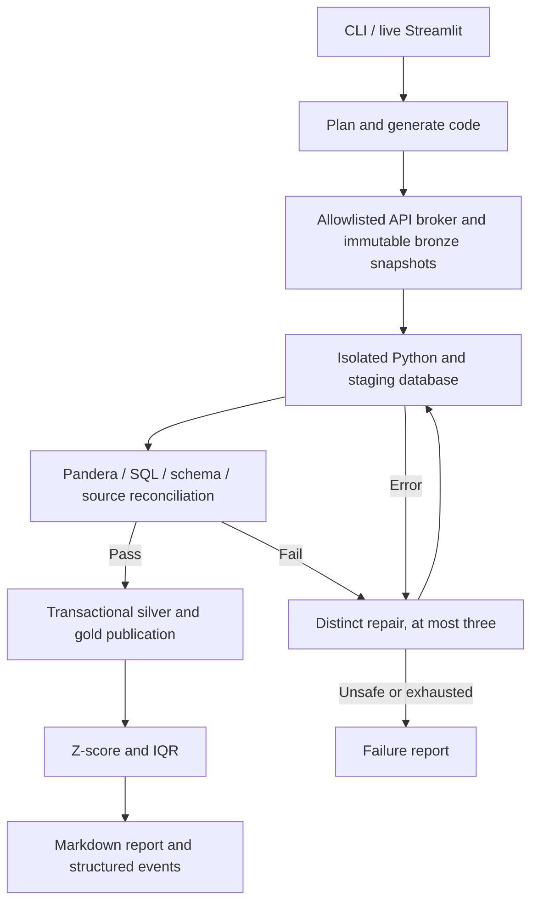

# FlowPilot

A working local data engineering agent for daily Bengaluru weather and air quality. It fetches real Open-Meteo data, preserves raw inputs, builds validated DuckDB hourly and daily tables, attempts bounded repairs, flags statistical anomalies, and produces an attributable report. The dark live frontend animates actual workflow events.

The default built-in engine runs without model credentials. Gemini, Groq and Ollama can generate plans/code inside the same validated catalog and sandbox boundaries.

## Run

```bash
cd agent-de
python3.11 -m venv .venv
source .venv/bin/activate
python -m pip install -r requirements.txt
python main.py run --provider builtin
streamlit run app.py
```

Python 3.11 and macOS sandbox-exec or Linux Docker are required. See [setup](docs/setup.md).

## Flow



## Hourly automation

```bash
python main.py schedule --install --provider builtin --frequency hourly --at 08:00 --timezone Asia/Kolkata
python main.py status
```

This installs a local macOS service. Keep the computer awake and project drive mounted; the UI can close. See [operations](docs/operations.md) for catch-up, logs, stopping and Linux operation.

## Verification

```bash
python -m pytest -q
FLOWPILOT_SANDBOX_TESTS=1 python -m pytest tests/test_sandbox.py -q
python -m eval.run_eval
```

Verified real Bengaluru ingestion: 139 hourly records, six daily summaries, and zero duplicates on rerun. The deterministic failure evaluation recovered nine of nine injected cases; see [measured results](eval/results.md) and its scope. External model adapters use mocked tests; live model credentials were not tested. Docker pipeline execution is now verified in GitHub Actions. Data is modeled weather/air-quality output, not direct sensor readings.

## Documentation

- [Architecture](docs/architecture.md), [full diagram](docs/architecture.mmd), [workflow](docs/workflow.md)
- [Setup](docs/setup.md), [frontend](docs/frontend.md), [operations](docs/operations.md)
- [Data model](docs/data-model.md), [tool map](docs/tools.md), [security](docs/security.md)
- [Testing](docs/testing.md), [evaluation](docs/evaluation.md), [walkthrough](docs/walkthrough.md), [implementation status](docs/implementation-plan.md)

Runtime data and secrets are ignored by Git. The supported scope is the environmental catalog with a fixed canonical output, single-writer local operation and bounded repair. Missing data is never fabricated. Arbitrary target migrations, long historical backfills and multi-tenant deployment need separate extensions.

Hourly is now the default local cadence, at minute 00 in Asia/Kolkata. Use `--frequency daily --at 08:00` to restore daily operation. See [cloud hosting](docs/hosting.md) for the independent free hourly cloud pipeline and public dashboard.

Public deployment: https://abhisheksd27.github.io/Flowpilot/ — the read-only dashboard updates from hourly cloud jobs at :47 IST. The local Streamlit app retains manual execution and SQL controls.
