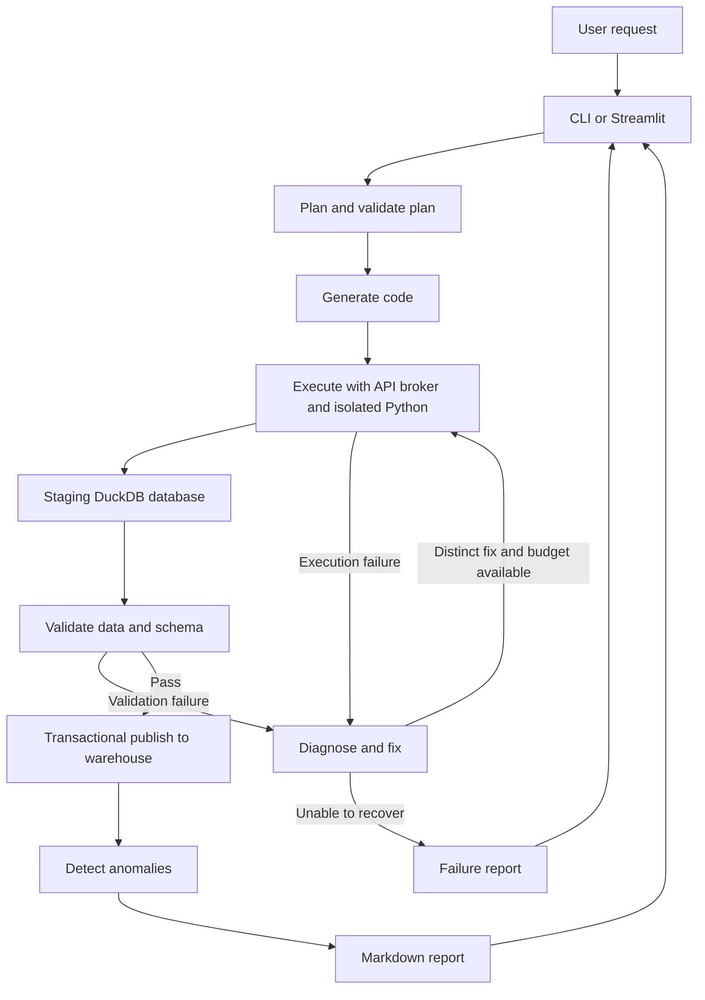

# Self-Healing Data Pipeline Agent

A Python 3.11 project that turns a plain-English weather and air-quality request into a pipeline that plans, ingests, transforms, loads, validates, attempts repairs, detects anomalies, and produces a Markdown report.

Example request:

> Track daily weather and air quality for Bengaluru and flag anomalies.

## Current status

This project is being built step by step. Environment setup is complete, as confirmed by the developer. Architecture and implementation guidance are documented. The end-to-end application is not implemented yet.

Starter modules exist for configuration, disk caching, API access, and LLM adapters. A Streamlit workflow simulation is present in `app.py`; result-panel guidance has been provided. Their presence does not mean they have passed tests. The real workflow, sandbox, warehouse tools, validation, anomaly detection, CLI, backend-connected UI, and evaluation remain to be implemented and verified.

The developer writes implementation code. The assistant maintains documentation and provides implementation guidance and review when requested.

## Architecture



The detailed [architecture](docs/architecture.md), [diagram source](docs/architecture.mmd), and [workflow](docs/workflow.md) explain the boundaries, state, and repair loop.

## Technology choices

- Open-Meteo for the catalog of weather, air-quality, and geocoding endpoints.
- DuckDB for the local warehouse and metadata.
- Pandas and NumPy for transformations and statistics.
- Pandera and SQL checks for validation.
- LangGraph for workflow orchestration.
- Gemini, Groq, or local Ollama through a common client interface.
- Streamlit for the interface and pytest for offline tests.

Use free-tier accounts where applicable. The application cannot guarantee provider quotas, model availability, or account billing settings. Local Ollama requires local compute and a separately installed model.

## Setup

From the project directory:

```bash
python3.11 -m venv .venv
source .venv/bin/activate
python -m pip install --upgrade pip
python -m pip install -r requirements.txt
```

See [setup and configuration](docs/setup.md) for environment variables, provider selection, and verification. Existing shell environment variables override the project `.env` file.

## Planned entry points

`streamlit run app.py` launches the existing simulation frontend. The other commands are intended for later implementation steps: `main.py`, test cases, and `eval/run_eval.py` are not present yet. The frontend does not yet run a real pipeline.

```bash
python main.py --request "Track daily weather and air quality for Bengaluru and flag anomalies."
streamlit run app.py
python -m pytest -q
python -m eval.run_eval
```

## Documentation guide

| Document | What it explains |
| --- | --- |
| [Implementation plan](docs/implementation-plan.md) | Steps, ownership, and completion criteria |
| [Frontend preview](docs/frontend.md) | Live workflow display, simulated events, and backend integration |
| [Architecture](docs/architecture.md) | Components, data boundaries, and design decisions |
| [Workflow](docs/workflow.md) | Node contracts, state, retry routing, and reporting |
| [Setup](docs/setup.md) | Installation and existing configuration behavior |
| [Data model](docs/data-model.md) | Dataset keys, quality rules, and schema metadata |
| [Tools](docs/tools.md) | Existing interfaces and planned tool contracts |
| [Security](docs/security.md) | Sandbox and SQL permission requirements |
| [Testing](docs/testing.md) | Offline tests, failure injection, and expected assertions |
| [Evaluation](docs/evaluation.md) | Success definitions and evaluation output |
| [Operations](docs/operations.md) | Logs, reruns, caches, and troubleshooting |
| [Walkthrough](docs/walkthrough.md) | One example request traced through the design |

## Evaluation status

| Evaluation | Execution status | Measured result |
| --- | --- | --- |
| Offline failure-injection suite | Not implemented or run | No success rate available |
| Live provider integration | Not run | No provider performance claim |
| Sandbox isolation tests | Not implemented or run | No isolation guarantee demonstrated |

Actual results will be generated into `eval/results.md`; they must never be inferred from the design or replaced with invented numbers.

## Assumptions and limitations

- Initial source support is limited to the Open-Meteo catalog; other domains require new tools and contracts.
- Initial operation allows one writer at a time. Concurrent writes require coordination before being supported.
- A schedule suggestion does not schedule a job; the user manually runs the initial application.
- Source timezones, aggregation, missing-data rules, and forecast semantics must be recorded in the plan.
- Statistical anomaly flags do not establish a real-world incident or causal explanation.
- Irrecoverable missing data must produce an honest failure or explicitly reported incomplete result.
- Generated Python requires verified operating-system or container isolation. Import restrictions alone are insufficient.
- Dependency ranges are not a reproducibility lockfile. Record installed versions when running evaluations.

## Future work

Add Prefect scheduling, dbt transformations and tests, additional API catalogs, longer anomaly baselines, dependency locking, and coordinated multi-user execution after the initial pipeline is verified.
